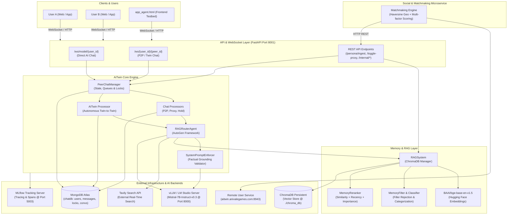
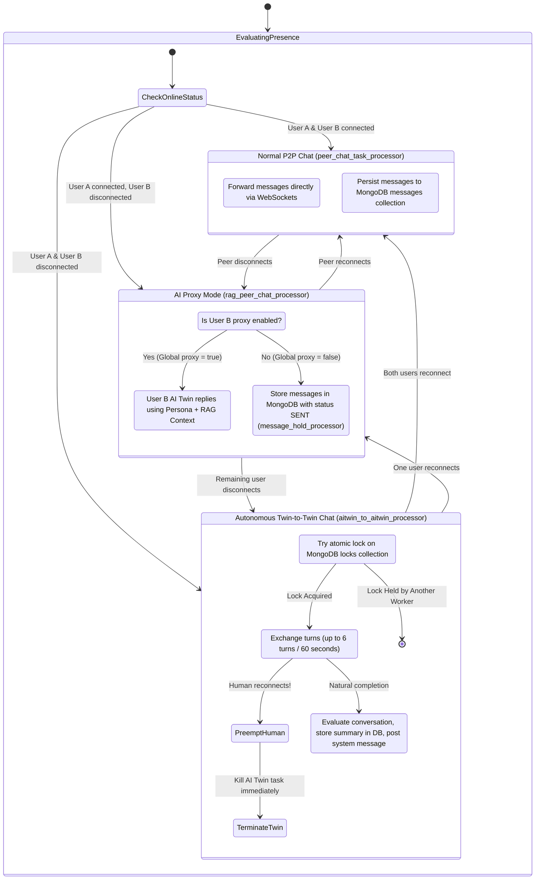
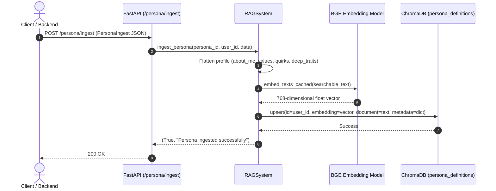
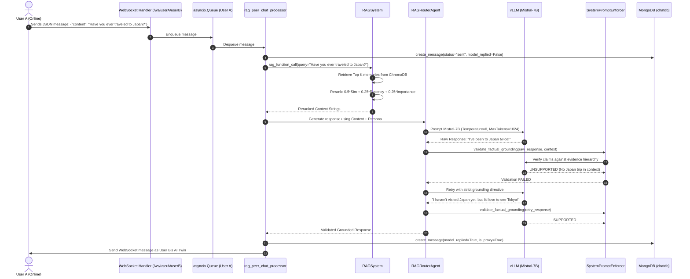

# 01: Project Architecture — AiTwin System Design

---

## 1. Architectural Pattern & Paradigm

The AiTwin system adopts a **hybrid architecture** combining:
1. **Modular Monolith for Core Real-Time Intelligence (`AiTwin_Model/src`):** A centralized asynchronous FastAPI service hosting WebSocket connections, conversational state machines, local dense embedding pipelines, vector storage (ChromaDB), and LLM orchestration (AutoGen + vLLM).
2. **Microservice Separation for Matchmaking & Discovery (`matchmaking/main_1.py`):** An independent HTTP service dedicated to geospatial filtering, multi-factor compatibility scoring, and user graph traversal.
3. **Event-Driven Asynchronous Concurrency:** WebSockets handle bidirectional communication, while Python `asyncio` task queues and distributed atomic locks manage background AI Twin execution without blocking real-time human chat.

---

## 2. High-Level System Architecture



---

## 3. Major Components & Responsibilities

| Component | File / Location | Primary Responsibility |
| :--- | :--- | :--- |
| **FastAPI Gateway** | `main.py` | Exposes REST APIs, WebSocket handlers, CORS configuration, startup/shutdown hooks, and MongoDB index initialization. |
| **PeerChatManager** | `peerChatManager.py` | Tracks active WebSocket connections in `active_connections`, manages user message queues (`message_queues`), loads history from cache/DB, and orchestrates twin triggers upon peer disconnects. |
| **Chat Processors** | `chat_processors.py` | Contains async event loops for the three peer states: `peer_chat_task_processor` (both online), `rag_peer_chat_processor` (one online, one proxied), and `message_hold_processor` (offline, proxy disabled). Hosts `AgentCircuitBreaker` and `AgentSupervisor`. |
| **AI Twin Processor** | `aitwin_chat_processor.py` | Executes the autonomous background conversation loop when both users are offline. Controls turn pacing, human reconnection interrupts, conversation summarization, and match score storage. |
| **RAGRouterAgent** | `agents.py` | Specialized `AssistantAgent` subclass (AutoGen). Builds persona-grounded prompts, enforces response contracts (max 3 sentences, 1st person), and registers RAG/Tavily search tools. |
| **SystemPromptEnforcer** | `agents.py` | Secondary LLM evaluation node enforcing factual grounding against `config/factual_grounding.md`. Validates whether generated claims are supported by context. Triggers prompt-rewriting retries on hallucination. |
| **RAGSystem** | `rag_system.py` | Interface to ChromaDB. Loads `BAAI/bge-base-en-v1.5`, generates normalized 768-dim embeddings, ingests documents/personas/messages, and executes cached context retrieval. |
| **Memory Intelligence** | `memory_utils.py` | Rejects filler/noise via `MemoryFilter`, categorizes items into types via `MemoryClassifier`, computes `ImportanceScorer` (0.0–1.0), and performs dynamic re-ranking via `MemoryReranker`. |
| **Data Access Layer** | `mongodb.py`, `mongo_crud.py` | Asynchronous database connection pooling via Motor. Provides CRUD methods for `users`, `conversations`, `messages`, and atomic TTL locks for `locks`. |
| **Matchmaking Engine** | `matchmaking/main_1.py` | Calculates Haversine distance filters and multi-factor compatibility scores (Semantic, Interest, Tone, Humor, Values, Activity). Requests AI ice-breakers from the main service. |
| **Observability Layer** | `mlflow_logger.py` | Wraps standard Python logging and OpenTelemetry/MLflow tracing (`start_span`, `log_latency`, `record_error`). Captures execution durations and error traces. |

---

## 4. Component Communication & Dynamic State Machine

When two users participate in a conversation on AiTwin, the conversation dynamically shifts across four distinct operational states depending on the real-time presence of both participants:



---

## 5. End-to-End Data Flow Architecture

The data pipeline spans three primary operational paths:

### Path A: Persona Ingestion & Vector Indexing Flow


### Path B: Real-Time Proxy Chat & Factual Grounding Flow


---

## 6. Authentication, Security & Inter-Service Trust

1. **Inter-Service Authentication:**
   Endpoints intended for internal microservices (`/internal/*`) employ an internal secret key check (`verify_internal_key`) using HTTP headers:
   ```python
   def verify_internal_key(internal_key: str = Header(None)):
       # Matches RAG_INTERNAL_KEY environment variable
       return True
   ```
2. **CORS Hardening:**
   Configured explicitly via environment variable `ALLOWED_ORIGINS` to avoid wildcard access with credentials:
   ```python
   _ALLOWED_ORIGINS = os.environ.get("ALLOWED_ORIGINS", "http://localhost:3000,http://localhost:5173").split(",")
   ```
3. **WebSocket Input Sanitization:**
   Incoming WebSocket payloads are inspected in `chat_utils.py` and rejected if they exceed `MAX_MESSAGE_LENGTH = 10000` characters.
4. **Adversarial Ingestion Shield:**
   In `rag_system.py`, messages with `model_replied=True` are strictly excluded from being inserted into the ChromaDB history collection, preventing AI hallucinations from becoming permanent memories.
