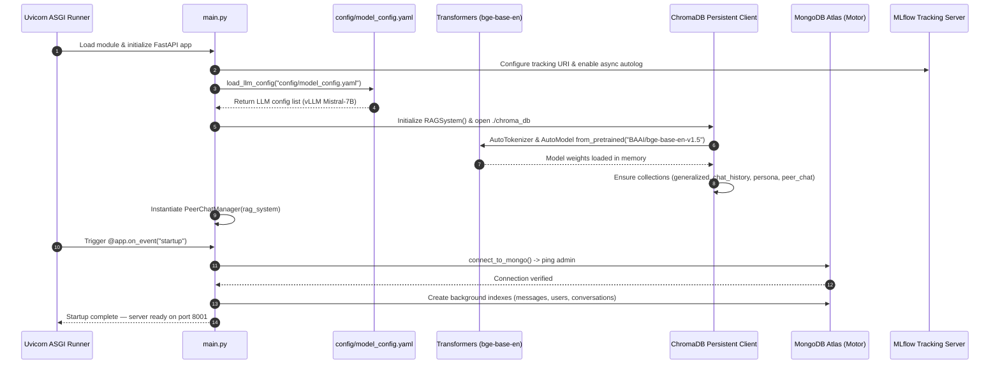
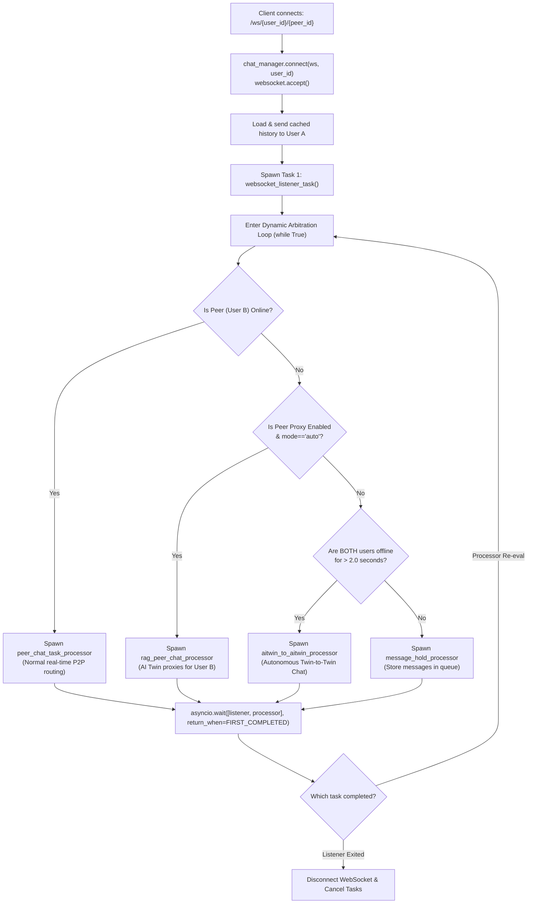
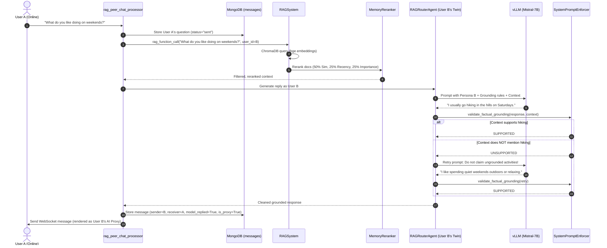

# 03: End-to-End Execution Flow — AiTwin

---

## 1. Application Startup Sequence

When the service starts (via `uvicorn main:app --host 0.0.0.0 --port 8001`), the execution flows as follows:



### Detailed Startup Steps:
1. **Module & Environment Setup:**
   `main.py` sets directory paths (`UPLOAD_DIR`, `DOWNLOAD_DIR`, `CHROMA_DB_PATH`) and initializes the global MLflow client with `mlflow.set_tracking_uri("http://localhost:5003")` and `mlflow.autogen.autolog()`.
2. **Model & RAG Initialization:**
   `load_llm_config("config/model_config.yaml")` parses configuration for `primary_response` and `rephrase_response`.
   `RAGSystem` initializes the Hugging Face `AutoTokenizer` and `AutoModel` for `BAAI/bge-base-en-v1.5`.
   ChromaDB creates or retrieves 4 persistent collections:
   - `generalized_collection`
   - `chat_history_collection`
   - `persona_definitions_collection`
   - `peer_chat_unified_collection`
3. **Session & Manager Setup:**
   `PeerChatManager` is instantiated, holding dictionaries for `active_connections`, `message_queues`, and `conversation_locks`.
4. **Lifecycle Hooks (`@app.on_event("startup")`):**
   `connect_to_mongo()` connects to the database using `motor.motor_asyncio.AsyncIOMotorClient` with a 5000ms server selection timeout.
   It creates indexes on MongoDB:
   - `messages`: `[("conversation_id", 1), ("timestamp", -1)]`
   - `users`: `user_id` (unique)
   - `conversations`: `participants` and `conversation_id` (unique)

---

## 2. WebSocket Connection Lifecycle & Chat Mode Arbitration

When a client initiates a WebSocket connection to `/ws/{user_id}/{peer_id}?persona_id=default`:



---

## 3. Execution Flow: Direct Model Chat (`model_chat_task_processor`)

When a user chats directly with their AI Twin via `/ws/model/{user_id}`:
1. `websocket_listener_task` receives message text, validates length ($\le 10,000$ characters), creates a standard message dict, and pushes it to `chat_manager.message_queues[user_id]`.
2. `model_chat_task_processor` dequeues the message.
3. It creates and saves a user message in MongoDB via `crud.create_message()`.
4. It initializes an AutoGen `RAGRouterAgent` configured with the selected persona.
5. `RAGRouterAgent` calls the RAG tool:
   - `rag_function_call(query)` queries ChromaDB `generalized_collection`.
   - Context is injected into the prompt.
6. The agent queries vLLM (Mistral-7B).
7. `SystemPromptEnforcer.validate_factual_grounding()` validates that the response does not claim ungrounded personal experiences.
8. The final grounded response is persisted to MongoDB (`model_replied=True`) and sent back to the user via WebSocket.

---

## 4. Execution Flow: Real-Time Peer Chat (`peer_chat_task_processor`)

When both User A and User B are connected:
1. User A sends a message over WebSocket.
2. `peer_chat_task_processor` dequeues the message.
3. Message is persisted to MongoDB with status `sent`.
4. The processor checks if User B is currently connected:
   - User B's WebSocket receives the message payload with status `delivered`.
   - Database record is updated to `received_status="delivered"`.
5. User A receives an acknowledgement confirming delivery.
6. When User B views/scrolls to the message, the client emits a `read` receipt, which updates MongoDB `received_status="read"`.

---

## 5. Execution Flow: AI Proxy Mode (`rag_peer_chat_processor`)

When User A is online but User B is offline and has AI Proxy enabled:



---

## 6. Execution Flow: Autonomous Twin-to-Twin Chat (`aitwin_to_aitwin_processor`)

When both users disconnect, AiTwin activates background social exploration:

```mermaid
sequenceDiagram
    autonumber
    participant Mgr as PeerChatManager
    participant MongoLock as MongoDB (locks collection)
    participant TwinProc as aitwin_to_aitwin_processor
    participant Agent as agents.generate_twin_reply
    participant MDB as MongoDB (messages & conversations)
    participant Eval as agents.summarize_and_evaluate_chat

    Mgr->>Mgr: Detect both User A and User B offline for > 2.0s
    Mgr->>MongoLock: crud.acquire_aitwin_lock(user_a, user_b, expire_in_seconds=300)
    alt Lock acquired
        MongoLock-->>TwinProc: Lock Granted
        TwinProc->>TwinProc: Reset turn counter (turn=0, max_turns=6)
        loop Up to 6 Turns (Alternating Turns)
            TwinProc->>TwinProc: Check if User A or User B reconnected
            Note over TwinProc: If either reconnects -> Break immediately!
            TwinProc->>Agent: generate_twin_reply(speaker, listener)
            Agent-->>TwinProc: Reply text
            TwinProc->>MDB: Store message (model_replied=True, is_proxy=True)
            TwinProc->>TwinProc: turn += 1; asyncio.sleep(0.4)
        end
        TwinProc->>Eval: summarize_and_evaluate_chat(session_messages)
        Eval-->>TwinProc: {summary: "...", status: "compatible / failed"}
        TwinProc->>MDB: update_conversation_extra_info(ai_match_summary, ai_match_status)
        TwinProc->>MDB: Add system message to chat history
        TwinProc->>MongoLock: crud.release_aitwin_lock(user_a, user_b)
    else Lock already held
        MongoLock-->>Mgr: Lock Denied (Worker already running)
    end
```

---

## 7. Execution Flow: Matchmaking Microservice (`matchmaking/main_1.py`)

1. **Request Ingestion:** Client calls `POST /matches/find` with `user_id`, `candidate_ids`, and `top_k`.
2. **User Data Hydration:** Fetches profiles from remote User Service (`USER_SERVICE_URL`).
3. **Geospatial Filtering:** Computes distance via Haversine formula:
   $$d = 2r \arcsin\left(\sqrt{\sin^2\left(\frac{\Delta\phi}{2}\right) + \cos(\phi_1)\cos(\phi_2)\sin^2\left(\frac{\Delta\lambda}{2}\right)}\right)$$
   Candidates outside the allowed radius (max 1.0 km) are discarded immediately.
4. **Vector Semantic Search:** Calls RAG Chatbot Service `POST /vector_similarity_search` to compute cosine similarity between BGE persona embeddings.
5. **Multi-Factor Scoring Formula:**
   $$\text{Compatibility} = 0.35 \cdot S_{\text{semantic}} + 0.25 \cdot S_{\text{interest}} + 0.10 \cdot S_{\text{tone}} + 0.10 \cdot S_{\text{humor}} + 0.10 \cdot S_{\text{values}} + 0.10 \cdot S_{\text{activity}}$$
6. **Ice-Breaker Generation:** For initiate endpoints (`POST /matches/initiate`), the service calls the AI model endpoint `POST /internal/generate_icebreaker_by_id`, generates a grounded opening message, stores it in MongoDB, and returns the match payload.
