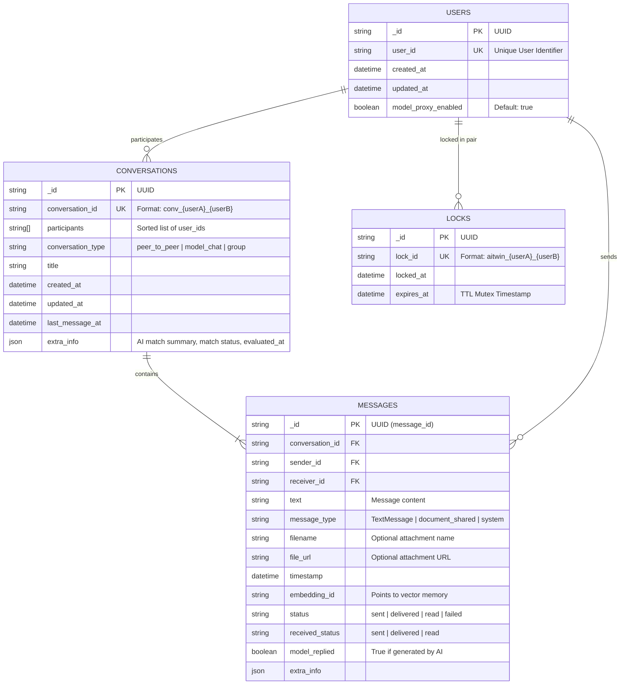

# 05: Database Design & Data Modeling — AiTwin

---

## 1. Multi-Database Architecture

AiTwin implements a dual-database architecture:
1. **MongoDB (NoSQL Document Store):** Serves as the source of truth for transactional chat data, user presence states, conversation threads, message delivery receipts, and distributed atomic locks.
2. **ChromaDB (Vector Database):** Serves as the semantic indexing engine for long-term episodic memories, persona profiles, and shared documents.



---

## 2. MongoDB Document Schemas (`mongo_models.py`)

### A. User Document (`users` collection)
```python
class User(MongoBaseModel):
    id: str = Field(default_factory=lambda: str(uuid.uuid4()), alias="_id")
    user_id: str                          # Business identifier
    created_at: datetime = Field(default_factory=datetime.utcnow)
    updated_at: datetime = Field(default_factory=datetime.utcnow)
    model_proxy_enabled: bool = Field(default=True) # Controls AI Proxy
```

### B. Conversation Document (`conversations` collection)
```python
class Conversation(MongoBaseModel):
    id: str = Field(default_factory=lambda: str(uuid.uuid4()), alias="_id")
    conversation_id: str                  # Deterministic: "conv_" + "_".join(sorted([u1, u2]))
    participants: List[str]               # e.g., ["user_101", "user_102"]
    conversation_type: ConversationType   # PEER_TO_PEER, MODEL_CHAT, etc.
    title: Optional[str] = None
    created_at: datetime = Field(default_factory=datetime.utcnow)
    updated_at: datetime = Field(default_factory=datetime.utcnow)
    last_message_at: Optional[datetime] = None
    extra_info: Optional[Dict[str, Any]]  # Holds ai_match_summary & ai_match_status
```

### C. Message Document (`messages` collection)
```python
class Message(MongoBaseModel):
    id: str = Field(default_factory=lambda: str(uuid.uuid4()), alias="_id")
    conversation_id: str
    sender_id: str
    receiver_id: Optional[str] = None
    text: str
    message_type: Literal["text", "TextMessage", "document_shared", "system", ...]
    filename: Optional[str] = None
    file_url: Optional[str] = None
    timestamp: datetime = Field(default_factory=datetime.utcnow)
    embedding_id: str                     # Compulsory foreign key to ChromaDB
    status: MessageStatus = MessageStatus.SENT
    received_status: MessageStatus = MessageStatus.SENT # Tracks delivery & read receipts
    model_replied: bool = False           # Flag identifying AI-generated messages
    extra_info: Optional[Dict[str, Any]] = None
```

### D. Distributed Lock Document (`locks` collection)
```python
class AITwinLock(MongoBaseModel):
    id: str = Field(default_factory=lambda: str(uuid.uuid4()), alias="_id")
    lock_id: str                          # Format: "aitwin_" + "_".join(sorted([u1, u2]))
    locked_at: datetime = Field(default_factory=datetime.utcnow)
    expires_at: datetime                  # Expiration for crash resilience
```

---

## 3. Database Indexes & Performance Optimization

Defined in `main.py` (`startup_event`) and executed asynchronously in the background:

```python
# 1. Message query acceleration (compound index for fast conversation pagination)
await database["messages"].create_index(
    [("conversation_id", 1), ("timestamp", -1)],
    background=True
)

# 2. User lookup acceleration (unique index)
await database["users"].create_index("user_id", unique=True, background=True)

# 3. Conversation participant filtering
await database["conversations"].create_index("participants", background=True)

# 4. Conversation identifier lookup (unique index)
await database["conversations"].create_index("conversation_id", unique=True, background=True)
```

---

## 4. ChromaDB Vector Topology (`rag_system.py`)

ChromaDB is instantiated as an embedded persistent client (`./chroma_db`) with 4 distinct collections:

| Collection Name | Content Stored | Embedding Dimension | Metadata Schema |
| :--- | :--- | :--- | :--- |
| `generalized_collection` | Global knowledge base files and documentation | 768 (`bge-base-en-v1.5`) | `filename`, `chunk_id`, `source`, `timestamp` |
| `chat_history_collection` | Episodic human user messages (filtered) | 768 (`bge-base-en-v1.5`) | `sender_id`, `receiver_id`, `timestamp`, `importance`, `memory_type` |
| `persona_definitions_collection` | User persona definitions and profiles | 768 (`bge-base-en-v1.5`) | `persona_id`, `user_id`, `tone`, `name`, `has_deep_traits` |
| `peer_chat_unified_collection` | Peer-to-peer shared files and documents | 768 (`bge-base-en-v1.5`) | `sender_id`, `receiver_id`, `filename`, `file_url`, `timestamp` |

---

## 5. Distributed Concurrency Control: The AI Twin Mutex

A critical architectural challenge in AiTwin is avoiding **split-brain execution** (e.g., if two load-balanced worker instances simultaneously attempt to run an AI Twin conversation between the same two offline users).

AiTwin solves this via an **atomic distributed lock** in MongoDB (`mongo_crud.acquire_aitwin_lock`):

```python
async def acquire_aitwin_lock(db, user_a: str, user_b: str, expire_in_seconds: int = 300) -> bool:
    sorted_users = sorted([user_a, user_b])
    lock_id = f"aitwin_{sorted_users[0]}_{sorted_users[1]}"
    now = datetime.utcnow()
    expires_at = datetime.utcfromtimestamp(now.timestamp() + expire_in_seconds)

    # 1. Try to acquire if expired
    result = await db["locks"].update_one(
        {
            "lock_id": lock_id,
            "expires_at": {"$lte": now}
        },
        {"$set": {"locked_at": now, "expires_at": expires_at}},
        upsert=False
    )
    if result.modified_count > 0:
        return True

    # 2. Try to insert new lock atomically ($setOnInsert)
    result = await db["locks"].update_one(
        {"lock_id": lock_id},
        {"$setOnInsert": {"lock_id": lock_id, "locked_at": now, "expires_at": expires_at}},
        upsert=True
    )
    return result.upserted_id is not None
```
- **Crash Recovery:** If a worker crashes mid-conversation, the lock automatically expires after 300 seconds ($5\text{ minutes}$), preventing permanent deadlocks.
- **Immediate Cleanup:** When the conversation completes naturally or a human reconnects, `release_aitwin_lock()` deletes the lock document immediately.
