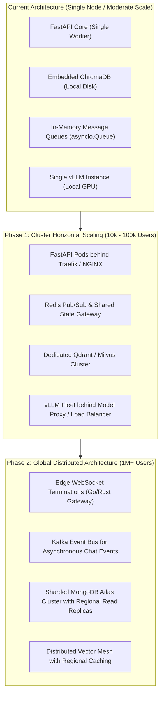

# 09: Security, Performance & Scalability Analysis — AiTwin

---

## 1. Security Analysis & Threat Modeling

AiTwin operates on deeply personal user data, including personality profiles, private chat history, deep psychological traits, and geospatial coordinates. Below is a rigorous audit of the security posture, vulnerabilities, and mitigations implemented in the codebase.

### A. Authentication & Microservice Perimeter Security
- **Inter-Service Verification:**
  Internal administrative and matchmaking endpoints (`/internal/*`) enforce a service key check via `verify_internal_key(internal_key: str = Header(None))`.
  - *Current Implementation:* Compares `internal_key` against `RAG_INTERNAL_KEY` from the environment.
  - *Production Hardening:* Enforce constant-time string comparison (`hmac.compare_digest`) to prevent timing attacks. Enforce mutual TLS (mTLS) between microservices when deployed across VPCs.
- **CORS Configuration:**
  In `main.py`, CORS origins are strictly loaded from `ALLOWED_ORIGINS` (defaulting to `http://localhost:3000,http://localhost:5173`) rather than open wildcards (`*`) with credentials, preventing Cross-Origin Request Forgery (CSRF) and credential leakage.

### B. Input Validation & Denial-of-Service (DoS) Defenses
- **WebSocket Payload Clamping:**
  In `chat_utils.py`, `MAX_MESSAGE_LENGTH = 10000` is enforced. Any incoming WebSocket frame exceeding 10,000 characters is rejected immediately before JSON parsing or tokenization, protecting memory buffers.
- **Per-User Sliding Window Rate Limiting:**
  In `agents.py`, `UserRateLimiter` enforces a 20 request-per-minute limit per user using a thread-safe sliding window algorithm (`threading.Lock()`). This prevents malicious clients from flooding the vLLM server with generation requests.
- **Supervisor Execution Timeouts:**
  In `chat_processors.py`, `AgentSupervisor.coordinate_agents()` wraps all model generation inside `asyncio.wait_for(timeout=30)`. Stalled or looping agent chains are killed after 30 seconds.

### C. Prompt Injection & Adversarial RAG Poisoning Defense
- **The AI Memory Poisoning Vulnerability (Solved):**
  A critical threat in digital twin systems occurs when an adversary chats with an AI Twin, causes it to hallucinate (e.g., "I own a red Ferrari"), and that message is subsequently saved into the user's permanent vector memory.
  - *Implemented Shield (`rag_system.py`, lines 592–660):*
    ```python
    # Adversarial Ingestion Filter
    if message.get("model_replied", False) is True:
        continue  # REJECT: AI-generated text is NEVER ingested into permanent user memory!
    ```
    Only verified, authentic human-authored messages are eligible for vector embedding, completely neutralizing AI memory poisoning.
- **Data Leakage in Observability:**
  Issue #16 fix in `agents.py` ensures that `deep_traits` and persona prompts are not written raw into MLflow span logs. Only prompt character lengths are logged, preventing PII leaks into centralized telemetry stores.

---

## 2. Performance Analysis & Bottlenecks

### Identified Bottlenecks & Code-Level Mitigations:

| Subsystem | Potential Bottleneck | Impact | Code-Level Mitigation Implemented in Repository |
| :--- | :--- | :--- | :--- |
| **Embeddings** | CPU/GPU contention during `model.forward()` | Blocks the async event loop if called synchronously | Offloaded to worker thread pool using `await asyncio.to_thread(self.embed_texts_cached, ...)` |
| **ChromaDB Queries** | Repeated semantic searches for identical or similar queries | High vector index traversal latency | In-memory `MemoryCache` (`query_cache`, `embedding_cache`) returns cached context on exact hash hits |
| **vLLM Inference** | Long queue times under high concurrent human load | Increased WebSocket message round-trip time | `AgentCircuitBreaker` trips to `OPEN` after 3 consecutive timeouts, immediately failing fast |
| **MongoDB History** | Querying large collections without indexing | High disk I/O and query latency | Background compound index on `[("conversation_id", 1), ("timestamp", -1)]` created at startup |
| **Twin Concurrency** | Two workers attempting autonomous chat simultaneously | Split-brain duplicate messages in chat | Atomic mutex lock via `crud.acquire_aitwin_lock()` on MongoDB `locks` collection |

---

## 3. Scalability Roadmap: From Prototype to 1,000,000 Users



### Specific Steps to Scale:
1. **Decouple WebSockets from Agent Workers (Redis Pub/Sub):**
   Currently, `chat_manager.active_connections` is an in-memory Python dictionary. To run multiple Uvicorn worker processes or Kubernetes pods, replace in-memory message queues with a Redis Pub/Sub cluster. When User A publishes a message, it is broadcast to the specific pod holding User B's active WebSocket.
2. **Migrate ChromaDB to Standalone Qdrant / Milvus:**
   Replace the local embedded ChromaDB persistent client with a dedicated high-throughput Qdrant or Milvus cluster running HNSW indexing with scalar quantization.
3. **vLLM Model Serving Autoscaling:**
   Deploy vLLM on a Kubernetes cluster managed by KEDA (Kubernetes Event-driven Autoscaling) or vLLM Distributed Serving, scaling GPU replicas based on pending queue depth.
4. **Sharding MongoDB:**
   Shard the `messages` collection across MongoDB shards using `conversation_id` as the hashed shard key.
