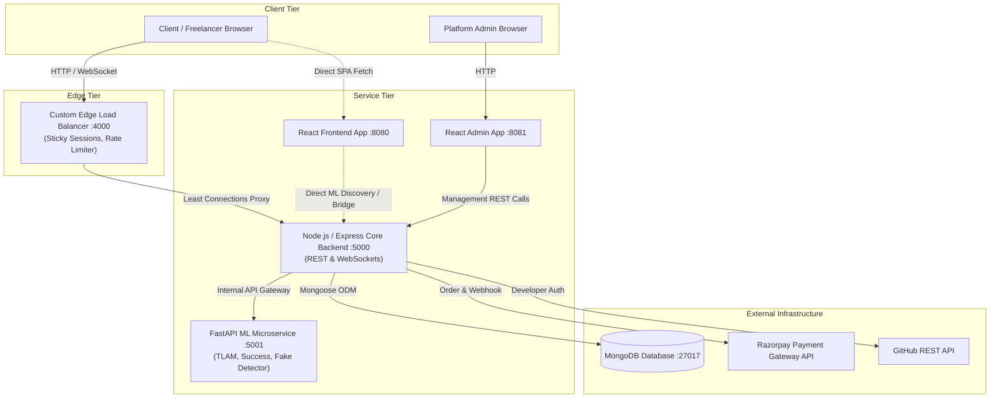

# 00: Project Overview & Problem Statement

> **Document ID**: `00_PROJECT_OVERVIEW`  
> **System Name**: FreelancerHub  
> **Architecture Pattern**: Distributed Multi-Service Architecture with AI Gateway & Custom Edge Proxy  
> **Domain**: Gig Economy / Freelance Talent Marketplace & Escrow Platform  

---

## 1. Executive Overview

**FreelancerHub** is an advanced, distributed digital freelancing platform designed to engineer trust, financial safety, and objective meritocracy in the freelance economy. Modern talent platforms (such as Upwork, Fiverr, and Freelancer.com) suffer from structural vulnerabilities: rampant fake profiles, inflated claims, fee-evasion disintermediation, subjective rating extortion, and protracted payment disputes.

FreelancerHub addresses these systemic market failures by integrating:
1. **Algorithmic Trust & Machine Learning**: Using the **TLAM (Trust-Layer Adaptive Matching)** engine to calculate objective candidate-project fit, alongside predictive models for project success and automated behavioral fake profile detection.
2. **Cryptographic Financial Security**: Pre-funded escrow mechanics integrated with Razorpay, strictly gated by digitally signed, versioned legal contracts with SHA content hashes.
3. **Objective Skill Verification**: Automated GitHub repository codebase analysis combined with timed, difficulty-tiered skill challenges, eliminating self-reported resume inflation.
4. **Automated Platform Integrity Protection**: Real-time sensitive information detection in chat to stop disintermediation, automated violation scoring with account strikes, and financial dispute arbitration requiring financial commitment bonds.

---

## 2. Problem Statement: Structural Failures in Modern Freelancing

Traditional freelance platforms operate on brittle economic and technical models:

```
┌────────────────────────────────────────────────────────────────────────┐
│                   TRADITIONAL FREELANCING PLATFORM PITFALLS            │
└────────────────────────────────────────────────────────────────────────┘
          │
          ├── 1. Profile Fraud & Resume Inflation
          │      └── Anyone can claim 10 years of React experience. No verifiable
          │          code proof or technical challenge gate exists.
          │
          ├── 2. Disintermediation & Platform Fee Bypass
          │      └── Clients and freelancers exchange emails/phone numbers in chat
          │          to take transactions offline, starving the platform of revenue.
          │
          ├── 3. Asymmetric Information & Poor Matchmaking
          │      └── Clients receive 50+ generic bids; linear matching formulas favor
          │          spam bidders rather than technically qualified freelancers.
          │
          ├── 4. Frivolous Disputes & Escrow Deadlocks
          │      └── Either party can file non-substantive disputes at zero cost,
          │          locking funds in escrow indefinitely.
          │
          └── 5. Rating Extortion & Subjective Reviews
                 └── Clients threaten 1-star reviews to demand free out-of-scope work;
                     reviews fail to reflect early deliveries, delays, or penalties.
```

### The FreelancerHub Solution Matrix

| Industry Vulnerability | Industry Norm | FreelancerHub Architectural Solution | Source Verification |
|---|---|---|---|
| **Fake & Inactive Profiles** | Unverified manual forms; bot-generated profiles dominate. | Machine Learning Fake Profile Detector analyzing 9 behavioral signals (profile completeness, skill-to-review ratio, account age). | [train_fake_detector.py](file:///e:/DEVOPS/freelancer-ml-project/train_fake_detector.py) |
| **Bypass of Platform Fees** | Manual or post-hoc account bans after client loss. | Real-time client-side regex detection of emails & phone numbers in chat messages + backend strike & violation tracking. | [ChatModal1.tsx](file:///e:/DEVOPS/frontend/src/components/ChatModal1.tsx#L97-L101) & [ViolationsView.tsx](file:///e:/DEVOPS/Freelancer-Admin/src/components/admin/ViolationsView.tsx) |
| **Unreliable Matching** | Simple keyword search or pay-to-win bidding. | Multiplicative TLAM formula ($C^\alpha \cdot R^\beta \cdot A^\gamma$) where missing skills immediately yield a zero score, preventing spam. | [api_gateway_integration.py](file:///e:/DEVOPS/freelancer-ml-project/api_gateway_integration.py#L190-L245) |
| **Frivolous Disputes** | Free dispute filing; administrative bottlenecks. | Mandatory Arbitration Fee payment gate via Razorpay before a dispute enters "Open" investigation. | [DisputePaymentSuccess.tsx](file:///e:/DEVOPS/frontend/src/pages/Disputes/DisputePaymentSuccess.tsx) |
| **Unclear Deliverables** | Verbal agreements via unencrypted chat. | Digitally signed, versioned Agreements with SHA content hashes, client/freelancer signatures, and IP/User-Agent tracking. | [AgreementDetails.tsx](file:///e:/DEVOPS/frontend/src/pages/Agreements/AgreementDetails.tsx) |
| **Subjective Feedback** | 5-star rating with no context. | Multi-dimensional rating (quality, timeliness, communication, professionalism) with context badges (early delivery, penalty, dispute). | [types/index.ts](file:///e:/DEVOPS/frontend/src/types/index.ts#L430-L460) |

---

## 3. Core Objectives of the Platform

1. **Deterministic Financial Integrity**: Guarantee that freelancers are paid when deliverables meet SLA conditions and that clients receive refunds if milestones fail, governed through an automated Escrow engine.
2. **Transparent Machine Learning Operations (MLOps)**: Provide complete explainability for AI decisions. Every match score returned by the ML service includes component breakdowns and learned feature weights visible to users.
3. **Multi-Tenant Administration & Governance**: Provide platform administrators with deep oversight capabilities: viewing violations, freezing suspect wallets, arbitrating disputes, reviewing flagged chat logs, and allocating bonuses or clawing back funds.
4. **End-to-End Data Confidentiality**: Prevent unauthorized eavesdropping on sensitive project negotiations through browser-native AES-GCM 256-bit chat encryption.
5. **Decoupled Service Scalability**: Allow machine learning inference, load balancing, admin operations, and marketplace browsing to scale independently.

---

## 4. Key Functional Modules & Capabilities

### 4.1 Client Project Management & Bidding
- **Project Posting**: Clients specify project requirements, budget, deadlines, category, and required skills with strict budget boundaries defined by platform settings.
- **Bidding Lifecycle**: Freelancers submit proposals with custom bid amounts and delivery days. Clients review proposals, inspect freelancer profiles, view AI Match scores, and accept proposals.
- **Project Work Submission**: Freelancers submit deliverables, link task check-offs, upload milestone artifacts, and track project completion states.

### 4.2 Legal Agreements & Cryptographic Contracts
- **Binding Contract Generation**: Acceptance of a bid triggers an immutable `Agreement` document containing project scope, deliverables, terms, agreed budget, and platform commissions.
- **Digital Signatures**: Both parties sign digitally. The system records the timestamp, client IP address, user-agent string, and generates a cryptographic `contentHash`.
- **Contract Amendments**: If project scope changes, an amendment is generated with version tracking (`version`, `previousVersion`, `amendmentReason`), requiring mutual re-signing.

### 4.3 Dynamic Milestone Management & SLA Multipliers
- **Structured Payouts**: Projects are divided into granular milestones with individual deadlines, SLA thresholds, and deliverable checklists.
- **Automated Bonus / Penalty Calculation**:
  - Early delivery before SLA deadline accrues early delivery bonuses (`bonusPercent`, `daysEarly`).
  - Late deliveries incur automated penalties (`penaltyPercent`, `daysLate`), directly adjusting the net payout.
- **Auto-Release Timers**: If a client fails to review a submitted deliverable within a specified SLA window, an automated release timer finalizes payment.

### 4.4 Razorpay Escrow & Financial Engine
- **Pre-Funded Escrow**: Clients must deposit milestone or full project amounts into Escrow before work begins via Razorpay Order creation.
- **Multi-State Escrow**: Tracks funds across states: `funded` $\to$ `released` / `refunded` / `disputed`.
- **Finance & Tax Dashboards**: Freelancers track gross earnings, estimated platform fees, net earnings, quarterly earnings breakdowns, and initiate bank withdrawals.

### 4.5 Multi-Tier Dispute & Arbitration Engine
- **Structured Categories**: Scope deviations, deadline breaches, communication breakdowns, and quality issues.
- **Arbitration Fee Gate**: Initiators must complete a Razorpay payment link to pay an arbitration fee, preventing frivolous claims.
- **Evidence Dossier**: Parties upload screenshots, documents, and link specific chat messages.
- **Admin Judicial Resolution**: Administrators can issue split settlements (e.g., 60% client refund / 40% freelancer payout), enforce clawbacks, or freeze accounts.

### 4.6 Dual-Method Skill Verification
- **GitHub Codebase Verification**: Direct integration with the GitHub API to inspect public repositories, primary languages, commit frequencies, pull requests, issues, CI/CD configs, and Dockerfiles, producing a verified proficiency score.
- **Time-Gated Skill Challenges**: Multiple-choice technical assessments with randomized question banks, difficulty tiers, and timed submission limits.
- **Verified Skill Badges**: Freelancers earn tier badges (Beginner, Intermediate, Advanced, Expert) prominently displayed on project bids.

### 4.7 Machine Learning Microservice
- **TLAM Matching Engine**: Multiplicative scoring combining Capability ($C$), Reliability ($R$), and Alignment ($A$).
- **Success Predictor**: Predicts completion probability (0–100%) using an 8-feature scikit-learn model with SBERT semantic embeddings.
- **Fake Profile Detector**: 9-feature behavioral anomaly detector flagging suspicious profiles with low completion, abnormal skill counts, or extreme rating-to-review ratios.

### 4.8 Administration & Platform Governance
- **Role-Based Admin Management**: Granular admin permissions, MFA/2FA setup with TOTP and backup codes, password rotation enforcement.
- **Violation Monitoring & Strikes**: Automated detection of contact-sharing in chat generates alerts; admins review evidence, issue strikes, freeze wallets, or ban users.
- **AI API Key Management**: Generation, rate limiting, request quotas, blocking, and unblocking of API keys used by external integration gateways.

### 4.9 Real-Time Encrypted Chat
- **WebSocket Streaming**: Instant bi-directional messaging between client and freelancer.
- **Client-Side AES-GCM 256-Bit Encryption**: Messages are encrypted and decrypted in the user's browser using the Web Crypto API.
- **Anti-Circumvention Filter**: Real-time evaluation blocking regex patterns for telephone numbers and email addresses before transmission.

---

## 5. System Boundaries & Integration Touchpoints



---

## 6. Summary of Architectural Scope

The FreelancerHub workspace encompasses the complete frontend client layer, the administrative control plane, the edge traffic manager, and the machine learning inference engine. It coordinates with a centralized Node.js core backend and MongoDB database.

Every engineering mechanism—from contract state machines to cryptographic message handling and machine learning weights—is implemented with explicit source code evidence documented throughout this manual.
