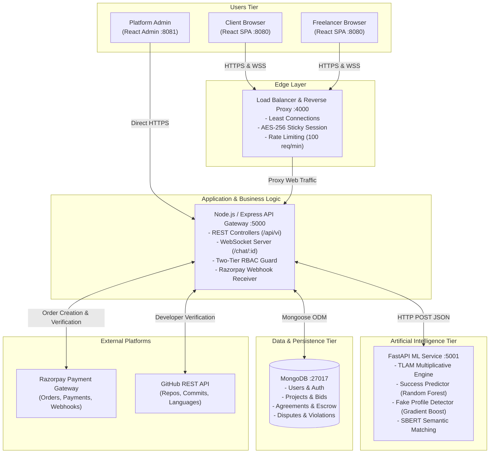
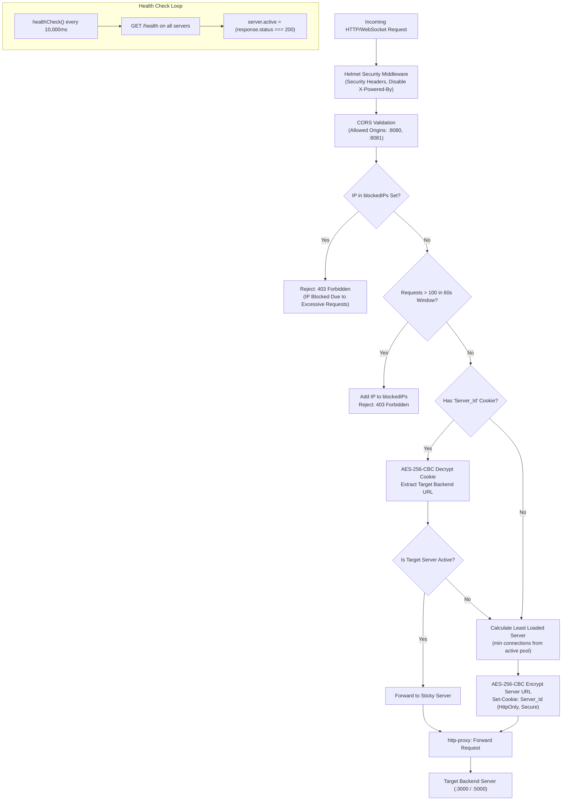
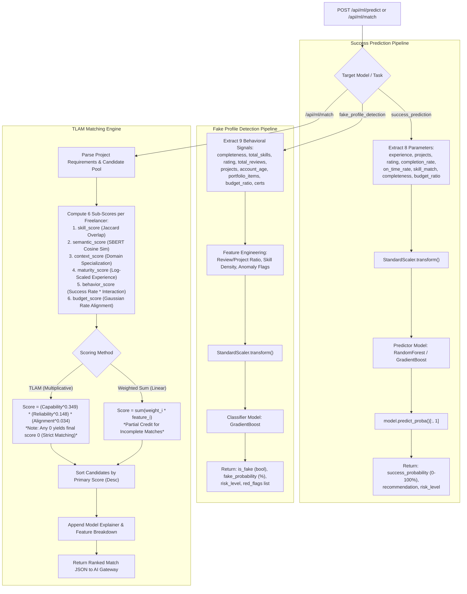
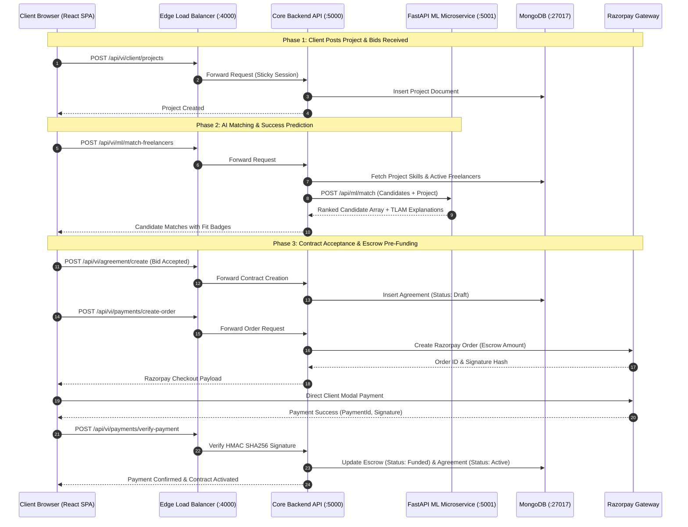
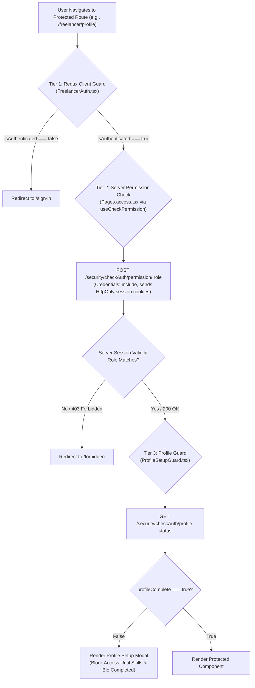
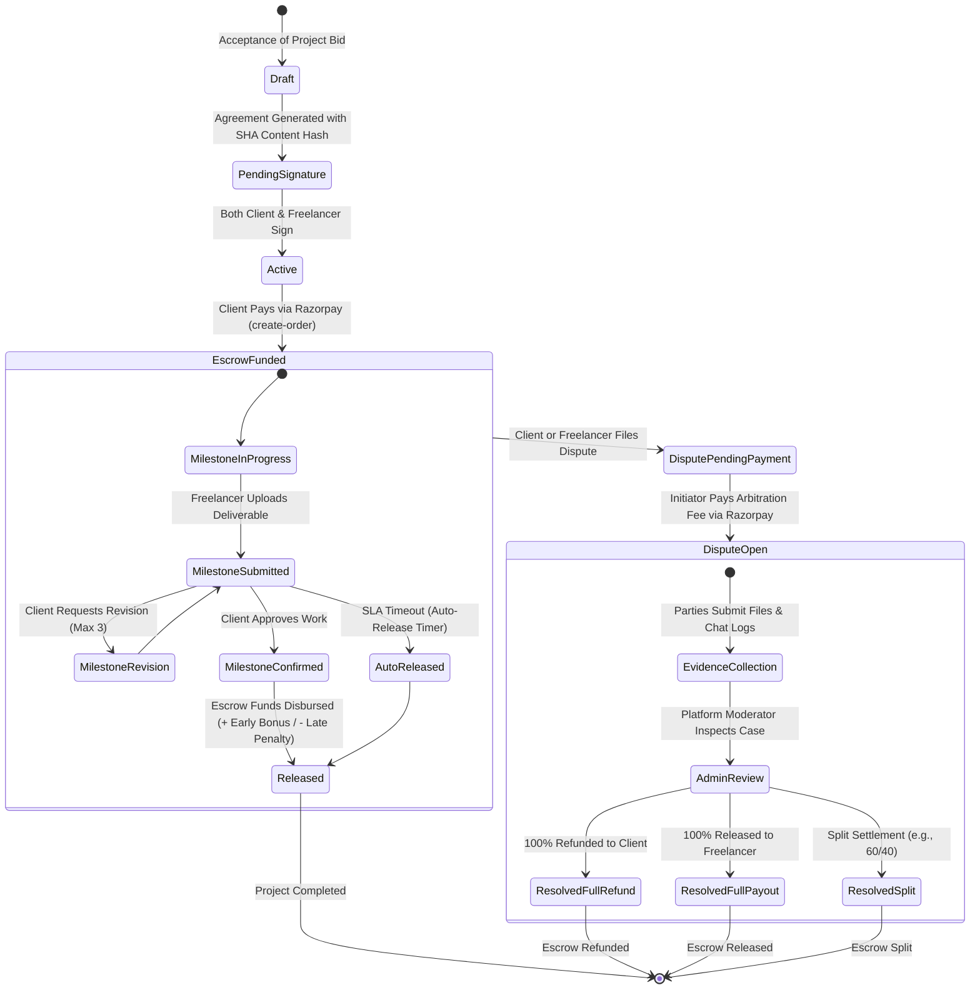

# 01: Project Architecture & System Design

> **Document ID**: `01_PROJECT_ARCHITECTURE`  
> **System Name**: FreelancerHub  
> **Architectural Pattern**: Distributed Microservices with Edge Proxy & AI Gateway Pattern  

---

## 1. Architectural Pattern & Paradigm

The FreelancerHub system implements a **Distributed Multi-Service / Hybrid Microservices Architecture**. Rather than deploying a monolithic codebase, the project separates concerns into discrete, independently deployable services optimized for distinct operational profiles:

```
┌────────────────────────────────────────────────────────────────────────┐
│                      DISTRIBUTED TOPOLOGY OVERVIEW                     │
└────────────────────────────────────────────────────────────────────────┘
  [Client Web App]        [Admin Portal]          [AI Gateway Client]
      (Port 8080)             (Port 8081)             (Port 8080)
           │                       │                       │
           ▼                       ▼                       ▼
  ┌──────────────────────────────────────────────────────────────────┐
  │         Edge Reverse Proxy & Custom Load Balancer (:4000)        │
  │     - Sticky Session Management (AES-256-CBC Encrypted Cookie)   │
  │     - Least-Connections Routing Algorithm                        │
  │     - IP Rate Limiting (100 req/min) & Permanent In-Memory Block │
  │     - Active Health Check Loop (every 10 seconds)                │
  └──────────────────────────────────────────────────────────────────┘
                                   │
                                   ▼
  ┌──────────────────────────────────────────────────────────────────┐
  │                 Core Node.js / Express Backend (:5000)           │
  │     - RESTful Business Logic (Projects, Contracts, Escrow)       │
  │     - Real-Time WebSocket Server (Chat & Events)                 │
  │     - Two-Tier Role-Based Access Control (RBAC)                  │
  │     - MongoDB Persistence Layer (Mongoose ODM)                   │
  └──────────────────┬─────────────────────────────┬─────────────────┘
                     │                             │
                     ▼                             ▼
        ┌─────────────────────────┐   ┌──────────────────────────────┐
        │  MongoDB Database       │   │ Python FastAPI ML Service    │
        │  (Port 27017)           │   │ (Port 5001)                  │
        │  - Document Collections │   │ - TLAM Multiplicative Engine │
        │  - Financial Ledgers    │   │ - Success Predictor          │
        │  - Audit Logs           │   │ - Fake Profile Classifier    │
        └─────────────────────────┘   └──────────────────────────────┘
```

### Architectural Classification
1. **Frontend / Admin Presentation Tier**: Decoupled Single-Page Applications (SPAs) built with React 18, Vite, TypeScript, and Tailwind CSS.
2. **Edge Network Tier**: Dedicated custom Node.js reverse proxy (`load-balancer/`) providing traffic distribution, connection pooling, and denial-of-service defense.
3. **Core Application Tier**: Express-based REST API and WebSocket daemon coordinating business transactions, escrow funding, contract signing, and chat streaming.
4. **Machine Learning / AI Tier**: Independent Python FastAPI microservice (`freelancer-ml-project/`) exposing high-speed model inference, vector scoring, and trust algorithms.
5. **Data Tier**: MongoDB document database supporting complex nested schemas (Milestones, Deliverables, Disputes, Violations).

---

## 2. Major Components & Responsibilities

| Component | Repository Path | Tech Stack | Port | Primary Responsibility |
|---|---|---|---|---|
| **Marketplace Frontend** | `frontend/` | React 18, Vite, TS, Tailwind, Redux, TanStack Query | 8080 / 5173 | Client & Freelancer user interface; project posting, bidding, digital agreement signing, milestone tracking, Web Crypto chat. |
| **Admin Control Plane** | `Freelancer-Admin/` | React 18, Vite, TS, Radix UI, TanStack Query | 8081 | Governance dashboard; dispute arbitration, wallet freezes, strike issuances, AI key quotas, platform fee adjustments. |
| **Edge Load Balancer** | `load-balancer/` | Node.js, Express, `http-proxy`, Helmet, Crypto | 4000 | Reverse proxy; least-connections traffic forwarding, AES-256 encrypted sticky session cookies, IP rate limiting. |
| **ML Inference Service** | `freelancer-ml-project/` | Python 3.10+, FastAPI, Scikit-learn, Pandas, SBERT | 5001 | ML predictions; TLAM matchmaking, project success probability scoring, behavioral fake profile classification. |
| **Core Backend Server** | *External Microservice* | Node.js, Express, WebSocket (`ws`), Mongoose | 5000 | Core REST endpoints (`/api/vi`), user auth sessions, Razorpay payment verification, WebSocket chat broadcast. |
| **Database Server** | *Infrastructure* | MongoDB | 27017 | Persistent document store for Users, Projects, Agreements, Milestones, Escrow, Disputes, and Violations. |

---

## 3. High-Level Architecture Diagrams

### 3.1 Distributed System Architecture



---

### 3.2 Edge Load Balancer Internal Architecture

The custom load balancer in [load-balancer/loadBalancer.js](file:///e:/DEVOPS/load-balancer/loadBalancer.js) acts as the intelligent ingress controller:



---

### 3.3 Machine Learning Microservice Architecture

The ML service in [freelancer-ml-project/api_gateway_integration.py](file:///e:/DEVOPS/freelancer-ml-project/api_gateway_integration.py) processes requests using serialized scikit-learn models and the TLAM engine:



---

## 4. Communication & Protocol Matrix

The platform orchestrates 4 distinct communication mechanisms across services:



---

## 5. Authentication & Authorization Architecture

FreelancerHub implements a **Two-Tier Authentication & RBAC Defense Model**:



### Admin Multi-Factor Authentication (MFA)
In the administration portal ([Freelancer-Admin/src/pages/Login.tsx](file:///e:/DEVOPS/Freelancer-Admin/src/pages/Login.tsx)), a 3-step security verification is enforced:
1. **Credentials Verification**: Email and password encrypted with `xorEncrypt` submitted to `/api/vi/Manager/login`.
2. **Mandatory Password Rotation**: If `data.requiresPasswordChange === true`, access is blocked until a new secure password is set.
3. **Time-Based One-Time Password (TOTP)**: If 2FA is active, a 6-digit authenticator code or one-time emergency backup code is verified against `/admin/settings/2fa/verify`.

---

## 6. End-to-End Chat & Encryption Architecture

The real-time communication channel uses a hybrid transport and cryptography pipeline:

```mermaid
sequenceDiagram
    autonumber
    participant A as User A Browser (Sender)
    participant WS as WebSocket Gateway (:5000)
    participant B as User B Browser (Receiver)

    Note over A: 1. Anti-Circumvention Content Inspection
    A->>A: Regex Check: Phone Numbers (/\b\d{10,15}\b/) & Emails
    alt Contains Sensitive Contact Data
        A-->>A: Abort send; Trigger Alert: "Sharing contact information violates platform policy"
    else Message Clean
        Note over A: 2. Web Crypto API AES-GCM Encryption
        A->>A: Generate random 12-byte IV (ivHex)
        A->>A: crypto.subtle.encrypt(AES-GCM, key, messageText)
        A->>A: Format payload: "ivHex:encryptedTextHex:authTagHex"
        A->>WS: Send JSON: {sender, receiver, message: ciphertext, timestamp}
        WS->>WS: Broadcast to connected socket of receiver
        WS->>B: Deliver WebSocket packet
        Note over B: 3. Web Crypto API AES-GCM Decryption
        B->>B: Split payload by ":" -> [ivHex, cipherHex, authTagHex]
        B->>B: crypto.subtle.decrypt(AES-GCM, key, combinedBuffer)
        B->>B: Render Plaintext Message in UI
    end
```

---

## 7. Escrow, Milestone & Dispute State Machine

Financial flows are strictly modeled as state machines with irreversible transitions:



---

## 8. Summary of Architectural Strengths & Vulnerabilities

### Architectural Strengths
- **Clean Service Decoupling**: Frontend, admin, load balancer, and ML inference can be deployed, scaled, and updated independently.
- **Explainable AI Integration**: Matchmaking scores expose sub-feature weights, avoiding "black box" machine learning skepticism.
- **Multi-Layered Security**: End-to-end encrypted chat, dual-guard route access, XOR wire obfuscation, and SHA contract integrity checks.

### Architectural Risks (Addressed in Deep Dive)
- **Single Point of Failure at Edge**: The custom load balancer relies on in-memory state; restarting wipes rate-limiting tracking and active connection counts.
- **Connection Decrement Defect**: The load balancer fails to decrement server connections upon successful request completion.
- **Symmetric Key Exposure**: The chat encryption key is compiled into client-side Vite bundles (`VITE_ENCRYPTION_KEY`).

*(Full trade-off evaluations and technical mitigations are detailed in [06_TRADEOFFS_AND_DESIGN_DECISIONS.md](file:///e:/DEVOPS/PROJECT_DOCUMENTATION/06_TRADEOFFS_AND_DESIGN_DECISIONS.md) and [09_SECURITY_PERFORMANCE_AND_SCALABILITY.md](file:///e:/DEVOPS/PROJECT_DOCUMENTATION/09_SECURITY_PERFORMANCE_AND_SCALABILITY.md).)*
