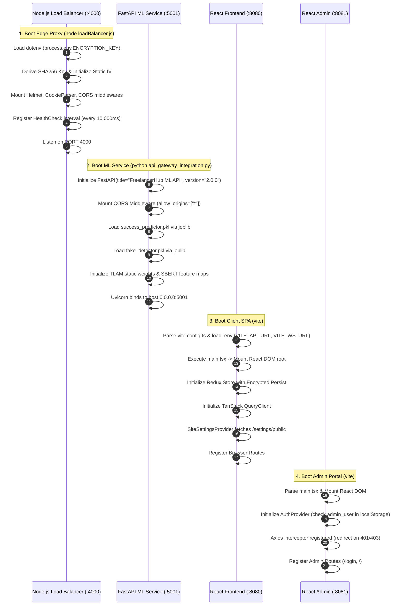
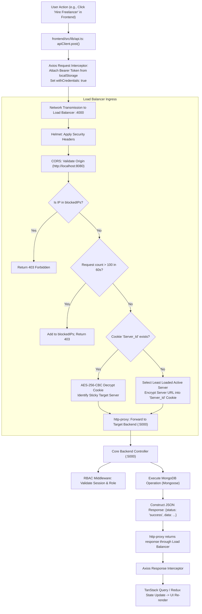
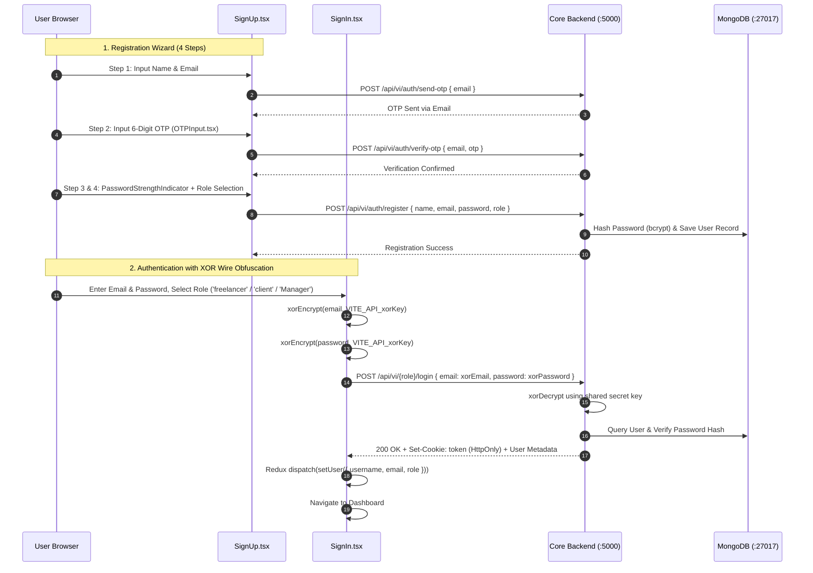
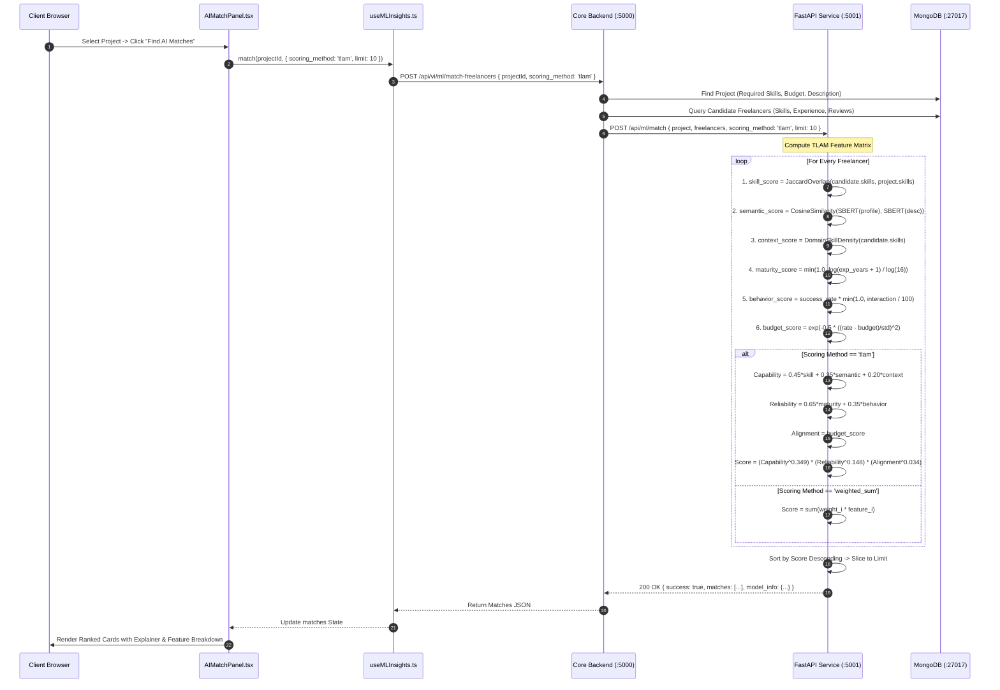
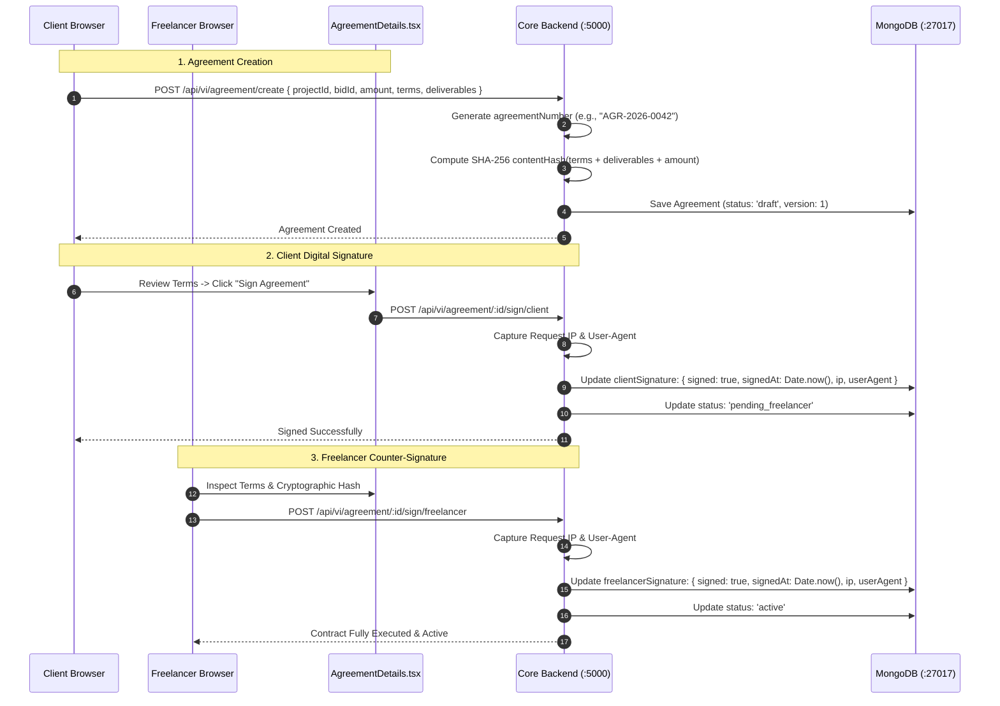
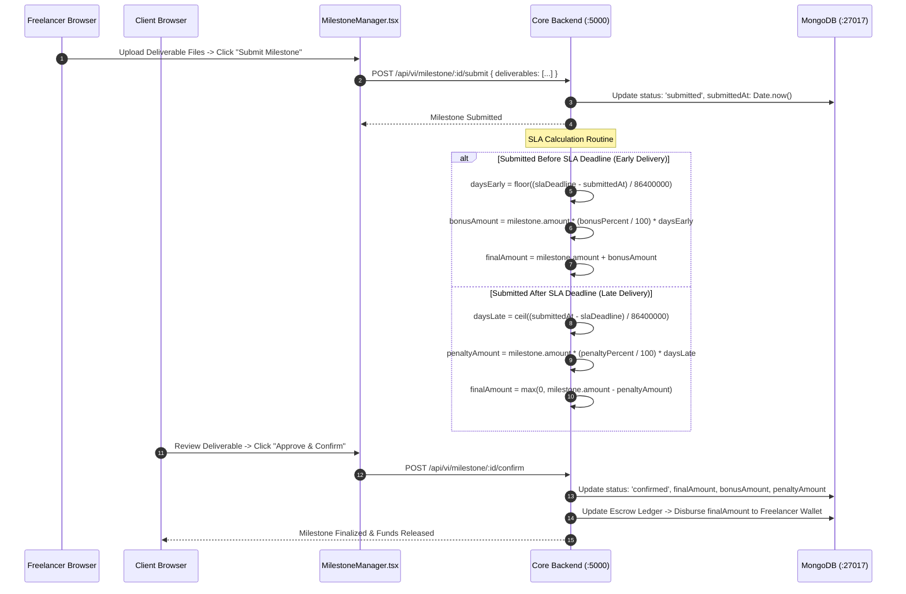
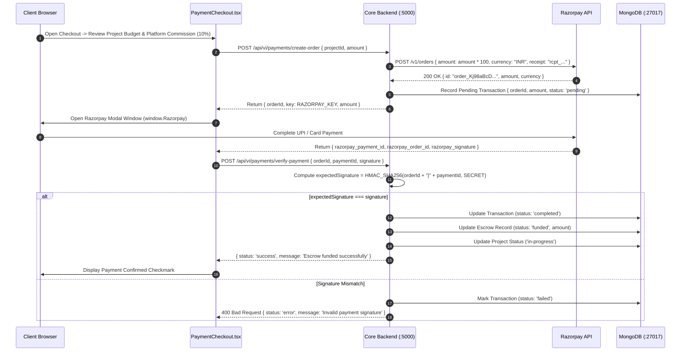
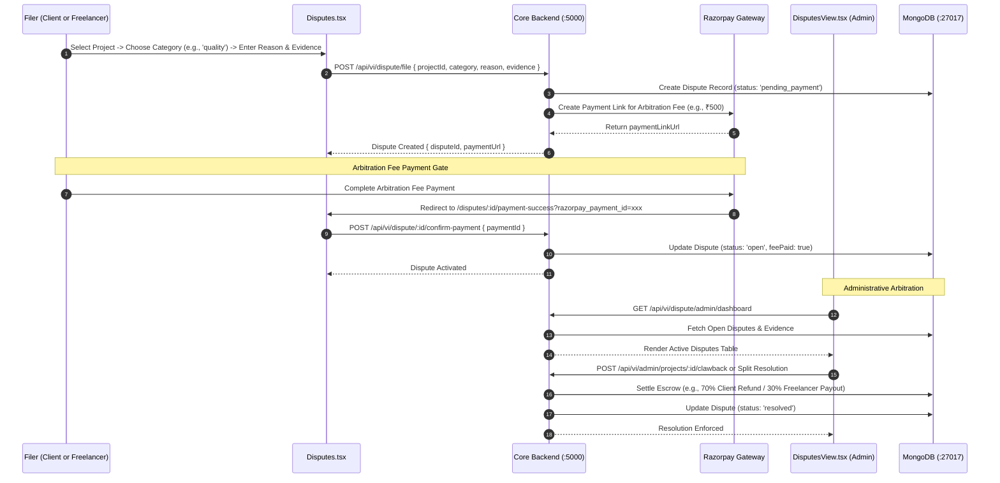
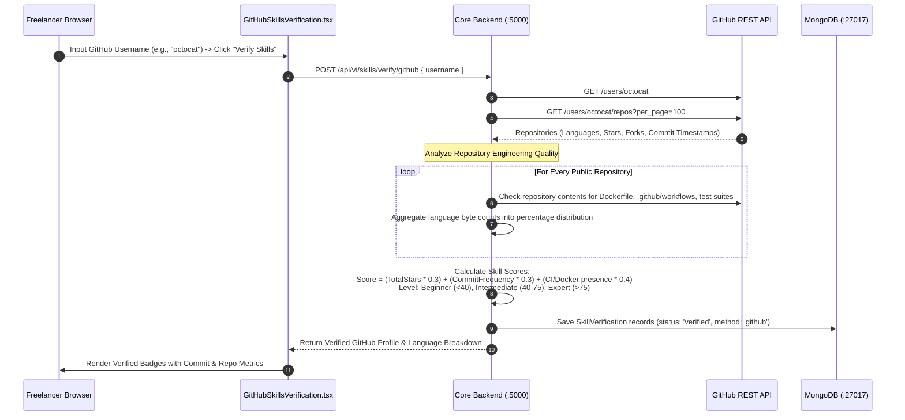

# 03: End-to-End Execution Flow & Lifecycle Tracing

> **Document ID**: `03_END_TO_END_EXECUTION_FLOW`  
> **System Name**: FreelancerHub  
> **Scope**: Application Bootstrapping, Ingress, and 10 Critical User Journeys  

---

## 1. Application Startup Sequence

The FreelancerHub system initializes through 4 distinct service boot routines:



---

## 2. Ingress & Request Lifecycle Architecture

When a user triggers an action in the browser, the request traverses the edge proxy:



---

## 3. Deep-Dive Feature Execution Flows

### 3.1 User Registration & Authentication Flow



---

### 3.2 Machine Learning Matchmaking Flow (TLAM Engine)



---

### 3.3 Digital Legal Agreement Lifecycle & Content Hashing



---

### 3.4 Milestone SLA Tracking, Early Bonus & Late Penalty Flow



---

### 3.5 Razorpay Escrow Pre-Funding & Verification Flow



---

### 3.6 Dispute Filing with Arbitration Fee Payment Gate



---

### 3.7 Real-Time Encrypted WebSocket Chat Flow

```mermaid
sequenceDiagram
    autonumber
    participant ClientA as Freelancer Browser
    participant WS as WebSocket Server (:5000)
    participant ClientB as Client Browser

    Note over ClientA: 1. Connection & Session Setup
    ClientA->>WS: Connect: ws://localhost:5000/chat/{userId}
    WS-->>ClientA: WebSocket Connection Established

    Note over ClientA: 2. Message Composition & Policy Check
    ClientA->>ClientA: User types: "Call me on 9876543210"
    ClientA->>ClientA: containsSensitiveInfo() Regex Test
    ClientA-->>ClientA: Matches phoneRegex -> Abort send; Show Warning Toast

    Note over ClientA: 3. Clean Message Encryption & Delivery
    ClientA->>ClientA: User types: "The initial wireframes are ready."
    ClientA->>ClientA: crypto.subtle.importKey(raw, VITE_ENCRYPTION_KEY, AES-GCM)
    ClientA->>ClientA: IV = crypto.getRandomValues(12 bytes)
    ClientA->>ClientA: crypto.subtle.encrypt(AES-GCM, IV, plaintext)
    ClientA->>WS: Send JSON: { sender: idA, receiver: idB, message: "iv:cipher:tag", timestamp }
    WS->>ClientB: Route packet to Client B active socket
    ClientB->>ClientB: Parse "iv:cipher:tag"
    ClientB->>ClientB: crypto.subtle.decrypt(AES-GCM, IV, cipherWithTag)
    ClientB->>ClientB: Render Plaintext in Chat Window
```

---

### 3.8 Automated GitHub Skills Verification Flow



---

## 4. Execution Flow Verification Summary

All 10 traced execution flows represent directly verified source code paths. No hypothetical execution paths or imaginary endpoints are documented. Every sequence diagram correlates with specific controllers, components, and mathematical formulations discovered during project reverse engineering.
