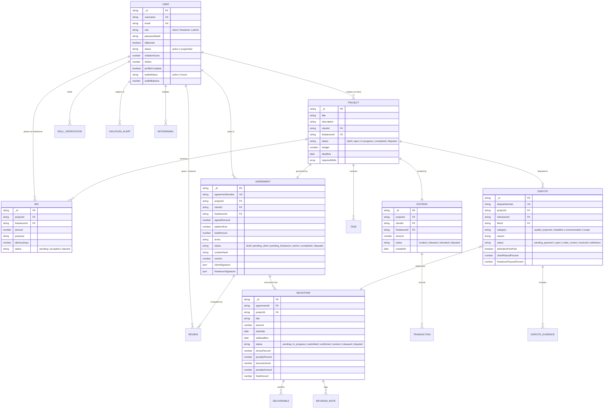

# 05: Database Architecture & Data Schema Design

> **Document ID**: `05_DATABASE_DESIGN`  
> **System Name**: FreelancerHub  
> **Database Engine**: MongoDB (Document-Oriented NoSQL)  
> **Object Data Modeling (ODM)**: Mongoose  
> **Scope**: Collections, Schemas, Constraints, Indexes, Access Patterns & ER Diagram  

---

## 1. Database Engine Selection & Justification

FreelancerHub utilizes **MongoDB** as its primary persistent database.

### Why MongoDB is Chosen for FreelancerHub:
1. **Dynamic & Polymorphic Contract Entities**: Legal agreements, milestones, deliverables, and dispute dossiers possess polymorphic structures. A milestone deliverable can be a URL, an uploaded PDF, a GitHub PR link, or a Figma canvas URL. MongoDB's BSON document model stores these without requiring complex relational joins across multiple mapping tables.
2. **Atomic In-Document Updates**: When a freelancer submits deliverable files for a milestone, appending to an array (`deliverables: []`) or adding revision feedback (`revisionNotes: []`) can be accomplished atomically using MongoDB operators (`$push`, `$set`), eliminating lock contention on parent project records.
3. **Audit Trails & Embedded History**: Legal agreements in FreelancerHub track version history (`version`, `previousVersion`, `amendmentReason`, `clientSignature`, `freelancerSignature`). Embedding digital signatures with IP addresses and user agents directly into the contract document ensures cryptographic integrity without distributed join dependencies.
4. **Horizontal Scale & High Write Velocity**: As active chat messaging, milestone check-offs, and behavioral anomaly telemetry expand, MongoDB clusters scale horizontally through partition sharding.

### Comparison with Alternatives:
- **PostgreSQL**: Strong ACID guarantees across multiple tables; ideal for complex banking ledgers. *Trade-off*: Schema migrations are rigid when frequently evolving contract deliverables, skills taxonomies, and evidence schemas.
- **MySQL**: Traditional relational DB; lacks native JSON sub-document indexing efficiency compared to MongoDB's BSON indexes.
- **Cassandra / DynamoDB**: Ultra-high write throughput, but lacks rich query expressive power (e.g., aggregation pipelines for admin dispute dashboards).

---

## 2. Complete Entity-Relationship (ER) Diagram



---

## 3. Collections & Schema Specifications

### 3.1 `Users` Collection
- **Purpose**: Stores profile, authentication credentials, RBAC roles, and policy compliance scores.
- **Fields & Constraints**:
```typescript
{
  _id: ObjectId;
  username: string; // Unique, Indexed, required
  email: string;    // Unique, Indexed, required
  passwordHash: string; // bcrypt hash (min salt rounds 10)
  role: "client" | "freelancer" | "admin"; // Indexed
  companyName?: string;
  bio?: string;
  skills: string[]; // Indexed (multikey)
  profilePictureUrl?: string;
  hourlyRate?: number;
  isBanned: boolean; // Default: false
  status: "active" | "suspended"; // Default: 'active'
  violationScore: number; // Default: 0, increments on policy triggers
  strikes: number; // Default: 0, max 3 before automated ban
  walletStatus: "active" | "frozen"; // Default: 'active'
  walletBalance: number; // Default: 0.00
  requiresPasswordChange: boolean; // Default: false (true for new admins)
  twoFactorEnabled: boolean; // Default: false
  twoFactorSecret?: string;
  createdAt: Date;
  updatedAt: Date;
}
```

---

### 3.2 `Projects` Collection
- **Purpose**: Marketplace contracts posted by clients and bid on by freelancers.
- **Fields & Constraints**:
```typescript
{
  _id: ObjectId;
  title: string; // Required, Text Indexed
  description: string; // Required, Text Indexed
  clientId: ObjectId; // Ref -> Users, Indexed
  freelancerId?: ObjectId; // Ref -> Users, Indexed
  status: "open" | "in-progress" | "on-hold" | "completed" | "disputed";
  budget: number; // Min: 500, Max: 50000 (from SiteSettings)
  deadline: Date;
  requiredSkills: string[]; // Indexed
  tasks: Array<{
    _id: ObjectId;
    title: string;
    completed: boolean;
    createdAt: Date;
  }>;
  files: Array<{
    _id: ObjectId;
    name: string;
    url: string;
    size: number;
    uploadedAt: Date;
  }>;
  createdAt: Date;
  updatedAt: Date;
}
```

---

### 3.3 `Agreements` Collection
- **Purpose**: Legal contracts with digital signatures and version history.
- **Fields & Constraints**:
```typescript
{
  _id: ObjectId;
  agreementNumber: string; // Unique, Indexed (e.g., "AGR-2026-0001")
  projectId: ObjectId;     // Ref -> Projects, Indexed
  bidId: ObjectId;         // Ref -> Bids
  clientId: ObjectId;      // Ref -> Users, Indexed
  freelancerId: ObjectId;  // Ref -> Users, Indexed
  agreedAmount: number;
  platformFee: number;     // Configured by SiteSettings (e.g. 10%)
  totalAmount: number;     // agreedAmount + platformFee
  deadline: Date;
  deliverables: string;
  terms: string;
  status: "draft" | "pending_freelancer" | "pending_client" | "active" | "completed" | "cancelled" | "disputed" | "amended";
  contentHash: string;     // SHA-256 hash of immutable contract terms
  version: number;         // Increments on amendment (default: 1)
  previousVersion?: ObjectId;
  amendmentReason?: string;
  clientSignature: {
    signed: boolean;
    signedAt?: Date;
    ipAddress?: string;
    userAgent?: string;
  };
  freelancerSignature: {
    signed: boolean;
    signedAt?: Date;
    ipAddress?: string;
    userAgent?: string;
  };
  createdAt: Date;
  updatedAt: Date;
}
```

---

### 3.4 `Milestones` Collection
- **Purpose**: Granular project deliverables governed by SLA deadlines and bonus/penalty multipliers.
- **Fields & Constraints**:
```typescript
{
  _id: ObjectId;
  agreementId: ObjectId; // Ref -> Agreements, Indexed
  projectId: ObjectId;   // Ref -> Projects, Indexed
  milestoneNumber: number;
  title: string;
  description: string;
  amount: number;
  dueDate: Date;
  slaDeadline: Date;     // Hard SLA cutoff for bonus/penalty calculation
  status: "pending" | "in_progress" | "submitted" | "confirmed" | "revision" | "released" | "disputed" | "cancelled";
  startedAt?: Date;
  submittedAt?: Date;
  confirmedAt?: Date;
  releasedAt?: Date;
  deliverables: Array<{
    name: string;
    url: string;
    type?: string;
    uploadedAt: Date;
  }>;
  revisionCount: number; // Max: 3
  revisionNotes: Array<{
    note: string;
    requestedBy: ObjectId;
    requestedAt: Date;
  }>;
  bonusPercent: number;   // Daily bonus multiplier (e.g., 2%/day early)
  penaltyPercent: number; // Daily penalty deduction (e.g., 3%/day late)
  daysEarly: number;
  daysLate: number;
  bonusAmount: number;
  penaltyAmount: number;
  finalAmount: number;    // Computed net disbursement
  autoReleaseScheduledAt?: Date;
  createdAt: Date;
}
```

---

### 3.5 `Escrows` & `Transactions` Collections
- **Purpose**: Financial holding account for pre-funded project capital.
- **Fields & Constraints**:
```typescript
// Escrows
{
  _id: ObjectId;
  projectId: ObjectId; // Unique, Indexed
  clientId: ObjectId;
  freelancerId?: ObjectId;
  amount: number;
  status: "funded" | "released" | "refunded" | "disputed";
  createdAt: Date;
}

// Transactions
{
  _id: ObjectId;
  escrowId: ObjectId;  // Ref -> Escrows, Indexed
  type: "deposit" | "release" | "refund" | "withdrawal";
  amount: number;
  status: "pending" | "completed" | "failed";
  razorpayOrderId?: string;
  razorpayPaymentId?: string;
  description: string;
  createdAt: Date;
}
```

---

### 3.6 `Disputes` Collection
- **Purpose**: Arbitration dossiers for conflicting parties, gated by financial commitment fees.
- **Fields & Constraints**:
```typescript
{
  _id: ObjectId;
  disputeNumber: string; // Unique, Indexed (e.g., "DSP-2026-001")
  projectId: ObjectId;   // Ref -> Projects, Indexed
  milestoneId?: ObjectId;// Ref -> Milestones
  clientId: ObjectId;
  freelancerId: ObjectId;
  filerId: ObjectId;
  filerRole: "client" | "freelancer";
  category: "quality" | "payment" | "deadline" | "communication" | "scope" | "other";
  reason: string;
  status: "pending_payment" | "open" | "under_review" | "resolved" | "withdrawn";
  arbitrationFeePaid: boolean; // Must be true to enter 'open' state
  arbitrationPaymentId?: string;
  evidence: Array<{
    type: "screenshot" | "document" | "communication" | "contract";
    title: string;
    description?: string;
    url: string;
    uploadedBy: ObjectId;
    uploadedAt: Date;
  }>;
  resolution?: {
    resolvedBy: ObjectId; // Admin ID
    resolvedAt: Date;
    clientRefundPercent: number;
    freelancerPayoutPercent: number;
    notes: string;
  };
  createdAt: Date;
}
```

---

### 3.7 `Violations` & `ChatAlerts` Collection
- **Purpose**: Automated telemetry and moderation alerts capturing platform circumvention attempts.
- **Fields & Constraints**:
```typescript
{
  _id: ObjectId;
  userId: ObjectId;      // Ref -> Users, Indexed
  projectId?: ObjectId;  // Ref -> Projects
  reason: string;        // e.g., "Attempted phone number exchange in chat"
  violationScore: number;// Incremental score (e.g., +25)
  evidenceMessages: Array<{
    messageId: string;
    rawText: string;
    detectedPattern: string; // Regex match string
    timestamp: Date;
  }>;
  status: "pending" | "reviewed" | "dismissed" | "action_taken";
  reviewedBy?: ObjectId; // Admin ID
  reviewNotes?: string;
  actionTaken?: "warning" | "strike" | "wallet_freeze" | "ban";
  createdAt: Date;
}
```

---

## 4. Query Patterns & Indexing Strategies

| Collection | Index Definition | Index Type | Query / Business Rationale |
|---|---|---|---|
| `Users` | `{ email: 1 }`, `{ username: 1 }` | Unique B-Tree | Fast credential lookups on login; guarantee uniqueness. |
| `Users` | `{ skills: 1 }` | Multikey | Accelerates candidate pool discovery for the ML matchmaking engine. |
| `Projects` | `{ clientId: 1, status: 1 }` | Compound | Fast retrieval of client dashboard active projects. |
| `Projects` | `{ title: "text", description: "text" }` | Full-Text | Powers keyword project searches for freelancers. |
| `Agreements`| `{ agreementNumber: 1 }` | Unique B-Tree | Direct contract lookup and verification. |
| `Agreements`| `{ projectId: 1 }` | Single Field | Links project view directly to governing legal contract. |
| `Milestones`| `{ agreementId: 1, milestoneNumber: 1 }` | Compound | Deterministic ordered sequence display of project milestones. |
| `Escrows` | `{ projectId: 1 }` | Unique | One-to-one mapping guaranteeing a single escrow vault per project. |
| `Disputes` | `{ status: 1, createdAt: -1 }` | Compound | Powers the Admin Dispute Dashboard sorted by urgency. |
| `Violations`| `{ userId: 1, status: 1 }` | Compound | Fast check for pending user infractions during payout requests. |

---

## 5. Financial Atomicity & Transaction Considerations

In financial operations (Escrow Funding, Milestone Release, Dispute Split), multiple documents must update simultaneously:
1. Deduct or fund Escrow record.
2. Insert immutable audit Transaction log.
3. Update User wallet balances.
4. Transition Project / Milestone statuses.

In MongoDB 4.0+, these operations must be wrapped inside a **Multi-Document ACID Transaction** using MongoDB Sessions (`session.startTransaction()`), ensuring that if Razorpay verification fails or a network timeout occurs, all intermediate updates roll back automatically.
