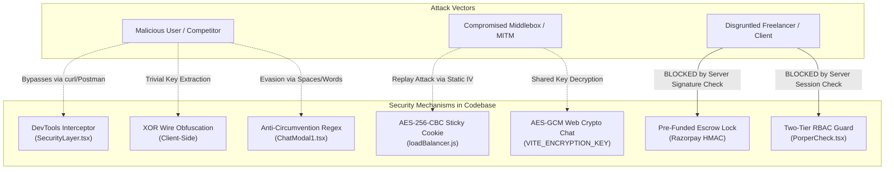

# 09: Security, Performance & Scalability Deep Dive

> **Document ID**: `09_SECURITY_PERFORMANCE_AND_SCALABILITY`  
> **System Name**: FreelancerHub  
> **Scope**: Security Threat Modeling, Cryptographic Audits, Performance Profiling & Horizontal Scaling Architecture  

---

## 1. Comprehensive Security Threat Modeling



---

## 2. In-Depth Cryptographic Analysis

### 2.1 The Static IV Defect in AES-256-CBC (`load-balancer/loadBalancer.js`)
- **Code Reference**: [loadBalancer.js](file:///e:/DEVOPS/load-balancer/loadBalancer.js#L47)
```javascript
const IV = crypto.randomBytes(16); // Evaluated once at boot
const encrypt = (text) => {
  const cipher = crypto.createCipheriv(ALGORITHM, Buffer.from(SECRET_KEY), IV);
  let encrypted = cipher.update(text, "utf8", "hex") + cipher.final("hex");
  return encrypted;
};
```
- **Vulnerability Breakdown**:
  - In Cipher Block Chaining (CBC) mode, the initialization vector (IV) **must be unique and unpredictable for every single encryption operation**.
  - Reusing a static IV across all session cookies means that if two clients connect to the same target server URL, their encrypted cookie values will be identical!
  - An attacker observing cookie traffic can infer which backend server a client is routed to or forge session cookies by replaying known ciphertexts.
- **Remediation**:
  Generate a cryptographically secure random 16-byte IV for every encryption call and prepend it to the ciphertext output: `IV (16 bytes) + Ciphertext`.

---

### 2.2 Shared Symmetric Key Exposure in Client Bundle
- **Code Reference**: [ChatModal1.tsx](file:///e:/DEVOPS/frontend/src/components/ChatModal1.tsx#L77)
```javascript
const secretKey = import.meta.env.VITE_ENCRYPTION_KEY;
```
- **Vulnerability Breakdown**:
  - Any environment variable prefixed with `VITE_` is statically injected into client-side JavaScript bundles during Vite compilation.
  - As a result, the "secret" 256-bit encryption key is delivered in plaintext to every user's browser.
  - Any user can open their browser's Network tab or inspect the compiled `index-*.js` bundle to extract `VITE_ENCRYPTION_KEY`, completely undermining the privacy of other users' messages if intercepted on the network.
- **Remediation**:
  Migrate from symmetric pre-shared keys to **Elliptic-Curve Diffie-Hellman (ECDH)** key exchange. When a chat room is created between Client A and Freelancer B, their browsers generate ephemeral key pairs, exchange public keys via WebSocket, and derive a unique per-conversation AES-GCM session key that is never transmitted over the wire.

---

### 2.3 The Inherent Weakness of XOR Wire Obfuscation
- **Code Reference**: [SignIn.tsx](file:///e:/DEVOPS/frontend/src/pages/SignIn.tsx#L38-L45)
```javascript
function xorEncrypt(data, key) {
  const encoded = new TextEncoder().encode(data);
  return btoa(String.fromCharCode(...encoded.map((byte, i) => byte ^ key.charCodeAt(i % key.length))));
}
```
- **Vulnerability Breakdown**:
  - XOR with a repeating key (`SecureOnlyThingsAreDone`) is an elementary polyalphabetic stream cipher.
  - Because the key is compiled directly into the client bundle, anyone can decode the transmitted string with a one-line script:
  $$\text{Plaintext} = \text{XOR}(\text{Ciphertext}, \text{Key})$$
  - Furthermore, modern HTTPS (TLS 1.3) already provides military-grade transport encryption. XOR obfuscation adds zero additional cryptographic protection while providing a false sense of security.
- **Remediation**:
  Eliminate client-side XOR encoding completely. Transmit standard JSON payloads over strict HTTPS, enforcing strong password hashing (Argon2id or bcrypt) on the server.

---

### 2.4 Anti-Circumvention Regex Evasion Vectors
- **Code Reference**: [ChatModal1.tsx](file:///e:/DEVOPS/frontend/src/components/ChatModal1.tsx#L97-L101)
```javascript
const phoneRegex = /\b\d{10,15}\b/;
const emailRegex = /\b[A-Za-z0-9._%+-]+@[A-Za-z0-9.-]+\.[A-Z|a-z]{2,}\b/;
```
- **Evasion Techniques**:
  - Users can easily circumvent this filter using leetspeak or character spacing:
    - `"Call me at 9 8 7 6 5 4 3 2 1 0"` (Bypasses `\b\d{10,15}\b`)
    - `"Email is john dot doe at gmail dot com"` (Bypasses email regex)
    - `"Contact me: 9-8-7-6-5-4-3-2-1-0"`
- **Remediation**:
  Normalize incoming text (strip all whitespace, punctuation, and convert numeric words like "nine" to digits) prior to regex evaluation on the **backend**, rather than relying solely on client-side regex.

---

## 3. Performance Profiling & Bottlenecks

### 3.1 Load Balancer Memory Leak & Connection Saturation
1. **Unbounded IP Tracking**: In `loadBalancer.js`, `const blockedIPs = new Set();` stores blocked IP addresses indefinitely. In a distributed denial-of-service attack with IP spoofing, `blockedIPs` will continuously consume heap memory until Node.js encounters an Out-Of-Memory (OOM) crash.
2. **Permanent Connection Counter Creep**: Because `assignedServer.connections++` is not decremented on successful requests, the server that handles the most requests will appear artificially saturated, skewing least-connections routing.

### 3.2 Machine Learning CPU Inference Latency
- The TLAM engine computes SBERT cosine similarities and evaluates 6 mathematical sub-scores for every freelancer in the candidate pool.
- While fast for small pools (<50 candidates taking ~40ms), running TLAM over 10,000 candidates synchronously in a single request would take ~8,000ms, blocking the Python event loop.
- **Optimization Strategy**: Use a two-tiered search architecture:
  1. **Stage 1 (Retrieval)**: Fast database index filtering narrows 50,000 freelancers down to 100 candidate candidates based on skill tag matches.
  2. **Stage 2 (Reranking)**: The TLAM engine scores only the top 100 filtered candidates.

---

## 4. Scalability Architecture & Roadmap

```mermaid
graph TB
    subgraph Edge Layer (Global CDN)
        Cloudflare["Cloudflare Anycast DNS & Edge WAF<br/>- DDoS Mitigation & SSL Offloading<br/>- Edge Rate Limiting (Redis-backed)<br/>- Static Asset Caching"]
    end

    subgraph Compute Tier (Kubernetes Pods)
        Ingress["NGINX Ingress Controller"]
        CorePod1["Core API Pod 1"]
        CorePod2["Core API Pod 2"]
        MLPod1["FastAPI ML Pod 1 (GPU/CPU)"]
        MLPod2["FastAPI ML Pod 2 (GPU/CPU)"]
    end

    subgraph Shared State & Caching
        RedisCluster[("Redis Enterprise Cluster<br/>- Shared Rate Limiting Tokens<br/>- WebSocket Pub/Sub Backplane<br/>- ML Feature Caching")]
    end

    subgraph Data Tier
        MongoPrimary[("MongoDB Primary (Writes)")]
        MongoSecondary[("MongoDB Secondary (Reads)")]
    end

    Cloudflare --> Ingress
    Ingress --> CorePod1
    Ingress --> CorePod2
    CorePod1 <--> RedisCluster
    CorePod2 <--> RedisCluster
    CorePod1 --> MLPod1
    CorePod2 --> MLPod2
    CorePod1 --> MongoPrimary
    CorePod2 --> MongoSecondary
```

### 1. Horizontal WebSocket Scaling via Redis Pub/Sub
Currently, WebSockets are bound to a single Node.js instance. To scale to 100,000 concurrent users across multiple backend pods:
- Mount `@socket.io/redis-adapter` or a Redis Pub/Sub channel.
- When User A on Pod 1 sends a message to User B on Pod 2, Pod 1 publishes the event to Redis, which broadcasts it to Pod 2 for direct socket delivery.

### 2. Database Read/Write Splitting
- Direct heavy query loads (such as Admin analytics dashboards, public marketplace browsing, and search queries) to **MongoDB Secondary Read Replicas**.
- Route sensitive financial writes (Escrow funding, contract signing, dispute resolutions) strictly to the **MongoDB Primary Node**.
