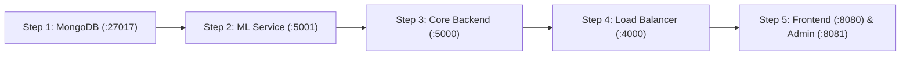

# 12: Local Setup, Execution & Runbook Guide

> **Document ID**: `12_SETUP_AND_RUN_GUIDE`  
> **System Name**: FreelancerHub  
> **Scope**: Local Development Setup, Docker Execution, Configuration Templates, and Troubleshooting  

---

## 1. Prerequisites & System Requirements

Before running the FreelancerHub platform, ensure your workstation meets the following runtime specifications:

### Runtime Requirements
- **Node.js**: `v18.x` or `v20.x` (LTS recommended)
- **Python**: `v3.10` or higher (with `pip` and `virtualenv`)
- **Package Managers**: `npm` (v9+) or `bun` / `pnpm`
- **Database**: MongoDB Community Server (`v6.0+`) or MongoDB Atlas connection URI
- **Docker**: Docker Desktop (v24+) with Docker Compose (optional for containerized run)

---

## 2. Repository Configuration & Environment Files

Create the following `.env` files in their respective project directories:

### 2.1 Frontend Client (`frontend/.env`)
Create `e:\DEVOPS\frontend\.env`:
```env
VITE_API_URL=http://localhost:5000/api/vi
VITE_WS_URL=http://localhost:5000
VITE_DISTPUTES_URL=http://localhost:4000
VITE_ADMIN_URL=http://localhost:8081/
VITE_API_xorKey=SecureOnlyThingsAreDone
VITE_ENCRYPTION_KEY=3C3538423A4B179E744B783246B2042531B049A431BB45ADCB3A529A1E1A98FF
VITE_RAZORPAY_KEY_ID=rzp_test_placeholderKey
```

### 2.2 Edge Load Balancer (`load-balancer/.env`)
Create `e:\DEVOPS\load-balancer\.env`:
```env
LOAD_BALANCER_PORT=4000
ENCRYPTION_KEY=0123456789abcdef0123456789abcdef
```

---

## 3. Step-by-Step Installation & Local Execution

Because FreelancerHub is a distributed multi-service system, services should be launched in separate terminal tabs in the following order:



---

### Step 1: Start MongoDB
Ensure the local MongoDB daemon is running:
```bash
# Windows PowerShell
net start MongoDB
# Or via mongod CLI
mongod --dbpath="C:\data\db"
```

---

### Step 2: Set Up & Launch Machine Learning Service (:5001)
```bash
cd e:\DEVOPS\freelancer-ml-project

# 1. Create and activate a Python virtual environment
python -m venv venv
.\venv\Scripts\Activate.ps1

# 2. Install dependencies
pip install -r requirements.txt

# 3. Train models (if .pkl files are not present)
python generate_data.py
python generate_fake_profiles.py
python train_success_model.py
python train_fake_detector.py

# 4. Start the FastAPI server on port 5001
python api_gateway_integration.py
```
- **Verification**: Open `http://localhost:5001/health` in your browser. It should return:
  `{ "status": "healthy", "models_loaded": true }`

---

### Step 3: Launch Custom Edge Load Balancer (:4000)
```bash
cd e:\DEVOPS\load-balancer

# 1. Install dependencies
npm install

# 2. Start the proxy server
npm start
```
- **Verification**: Terminal will log:
  `[INFO]: Load balancer running on port 4000`

---

### Step 4: Launch Marketplace Frontend (:8080 / :5173)
```bash
cd e:\DEVOPS\frontend

# 1. Install dependencies
npm install

# 2. Start the Vite development server
npm start
```
- **Access**: Open `http://localhost:8080` (or `http://localhost:5173`) in your browser.

---

### Step 5: Launch Administration Portal (:8081)
```bash
cd e:\DEVOPS\Freelancer-Admin

# 1. Install dependencies
npm install

# 2. Start the Vite admin server
npm run dev -- --port 8081
```
- **Access**: Open `http://localhost:8081` in your browser.

---

## 4. Docker Container Execution

### Building and Running the Frontend via Docker
```bash
cd e:\DEVOPS\frontend

# 1. Build the Docker image
docker build -t freelancer-hub-frontend:v1 .

# 2. Run the container mapping host port 8080
docker run -d --name freelancer-frontend -p 8080:8080 freelancer-hub-frontend:v1

# 3. Check logs
docker logs -f freelancer-frontend
```

---

## 5. Troubleshooting & Common Pitfalls

| Issue / Error Message | Root Cause | Solution / Fix |
|---|---|---|
| `[PROXY ERROR]: Failed to forward to http://localhost:3000` | The load balancer's target backend in `config/server.js` is offline or pointing to an inactive port. | Ensure your backend server is running on the port defined in `load-balancer/config/server.js` (update port to `5000` if needed). |
| `FastAPI: Error loading models: [Errno 2] No such file or directory: 'success_predictor.pkl'` | The ML model artifacts have not been trained yet. | Run `python train_success_model.py` and `python train_fake_detector.py` inside `freelancer-ml-project/` to serialize the `.pkl` files. |
| `DevTools Detected! Access Denied.` | `SecurityLayer.tsx` detected that your browser window width/height difference exceeds 200px. | Close browser developer tools or undock them into a separate standalone window. |
| `CORS Error: Not allowed by CORS` in browser console | The incoming origin is not included in `allowedOrigins` in `loadBalancer.js`. | Add your client origin (e.g., `http://localhost:5173`) to `allowedOrigins` in `load-balancer/loadBalancer.js`. |
| `TypeError: Cannot read properties of undefined (reading 'connections')` | The load balancer compared `connections` before the property was initialized on server objects. | Initialize `{ url: "http://localhost:5000", active: true, connections: 0 }` in `load-balancer/config/server.js`. |
| `403 Forbidden` on route navigation | Server session expired or user lacks the required portal role. | Navigate to `/sign-in` and authenticate with an account holding the appropriate role (`freelancer` or `client`). |
